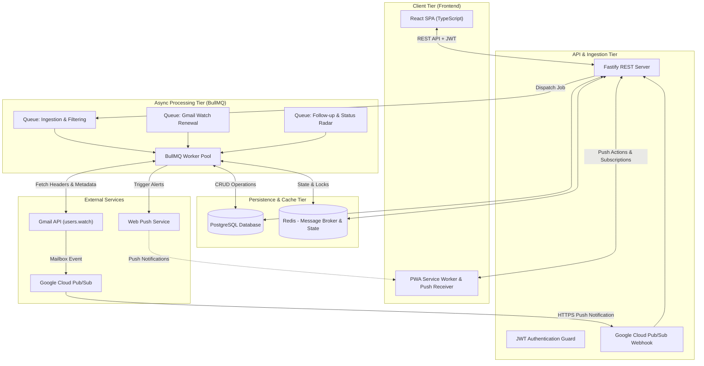
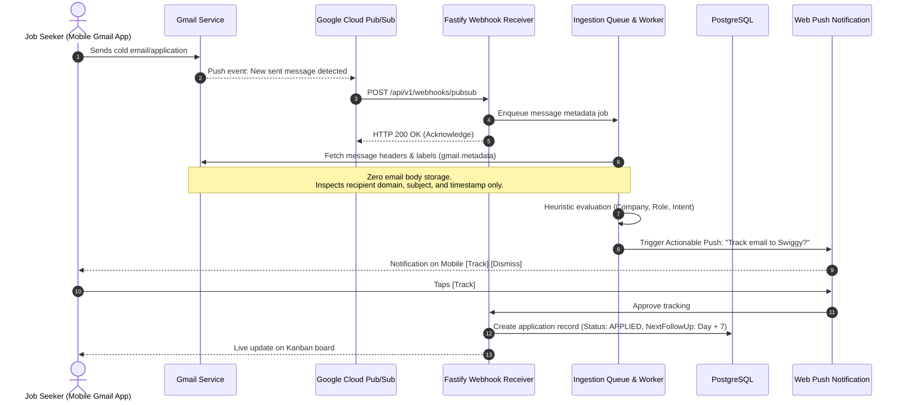
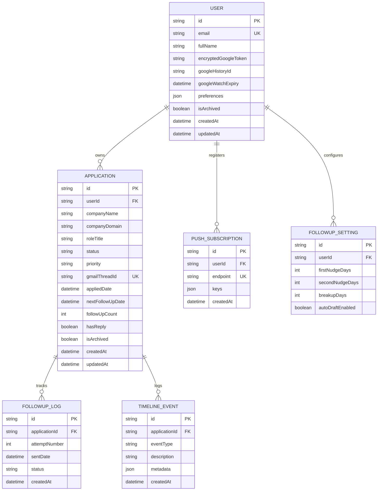
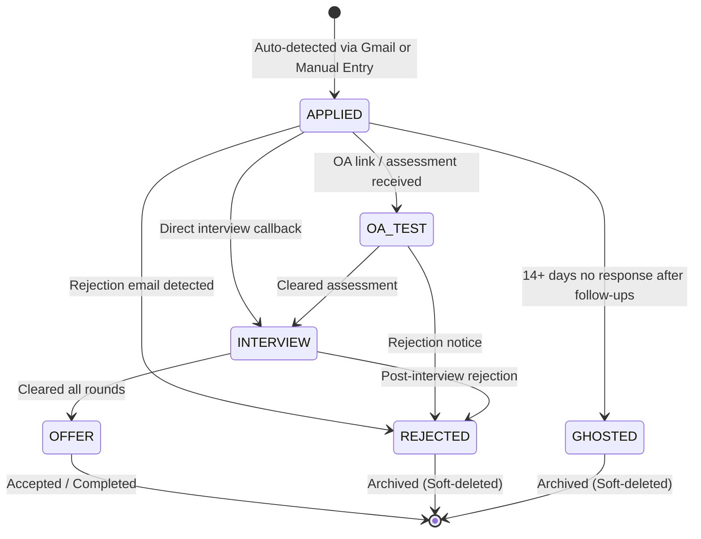
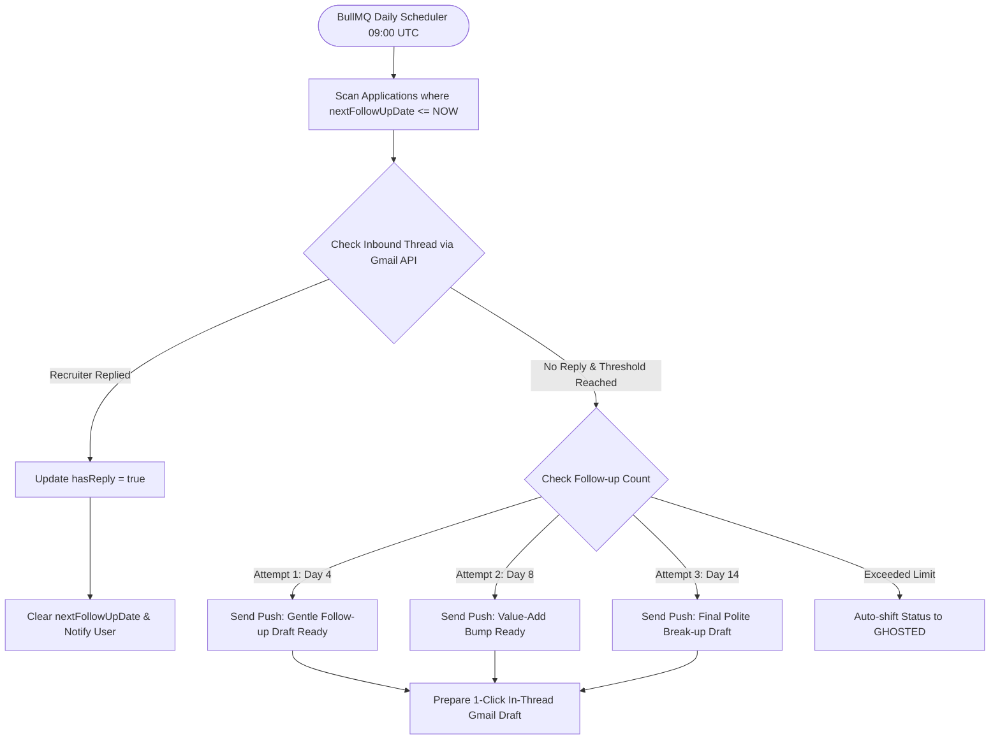
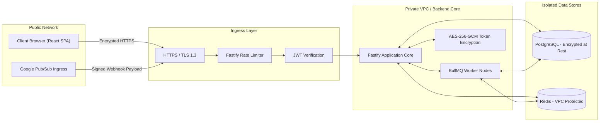
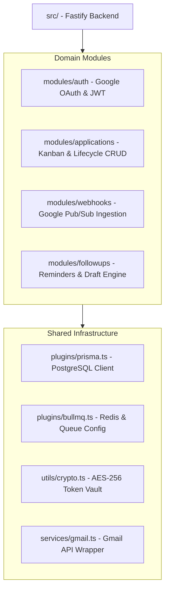

# ApplyTracker - System Architecture Blueprint

> **Aesthetic & Style:** Cal AI / Linear Minimal Tracker with Zero-Effort Gmail Sync  
> **Tech Stack:** React (TypeScript) + Fastify (TypeScript) + PostgreSQL (Prisma) + Redis & BullMQ + JWT  

---

## 1. High-Level System Architecture

---

## 2. Real-Time Gmail Ingestion Flow (Killer Feature)

---

## 3. Data Model & Entity Relationships (ER Diagram)

---

## 4. Application Lifecycle & Kanban State Transitions

---

## 5. Automated Follow-Up Radar Architecture

---

## 6. Security, Trust Boundary & Data Isolation

---

## 7. Modular Service Architecture (Fastify Backend)

