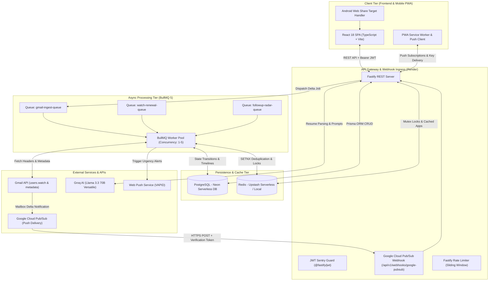
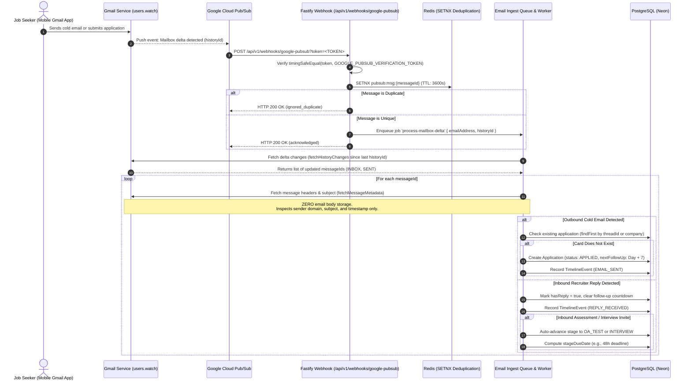
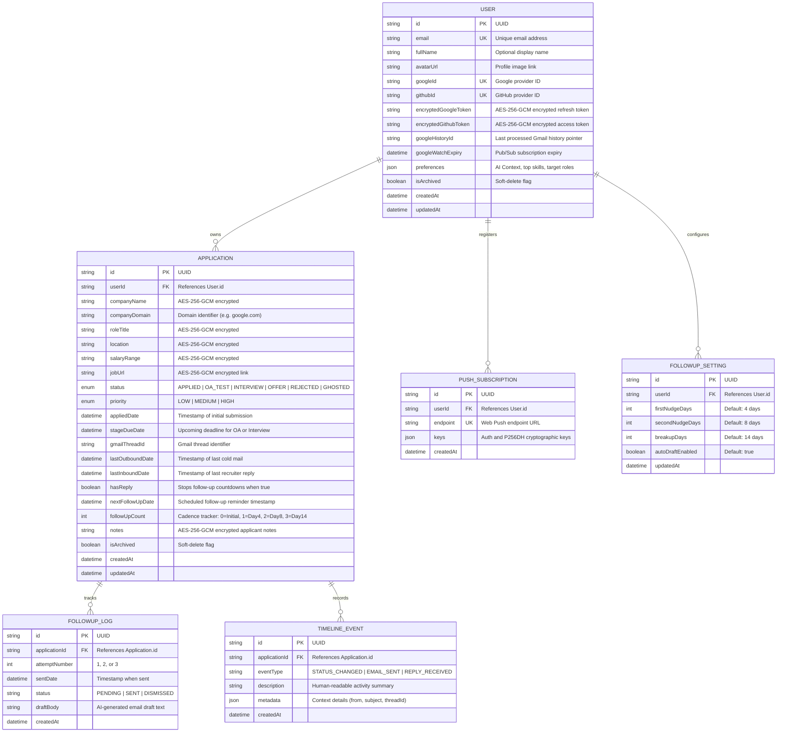
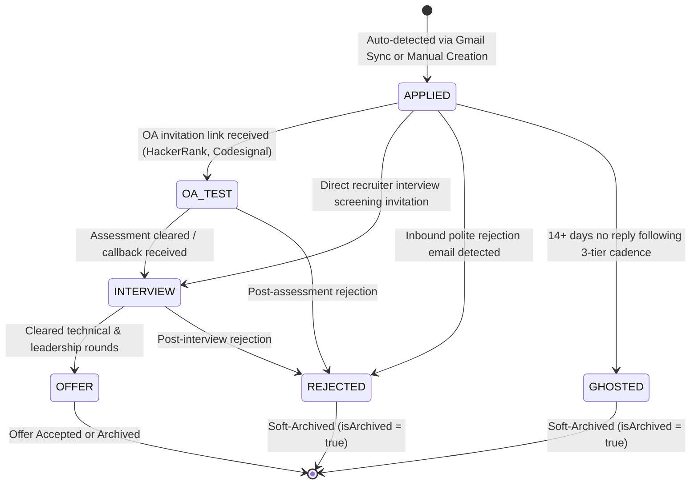
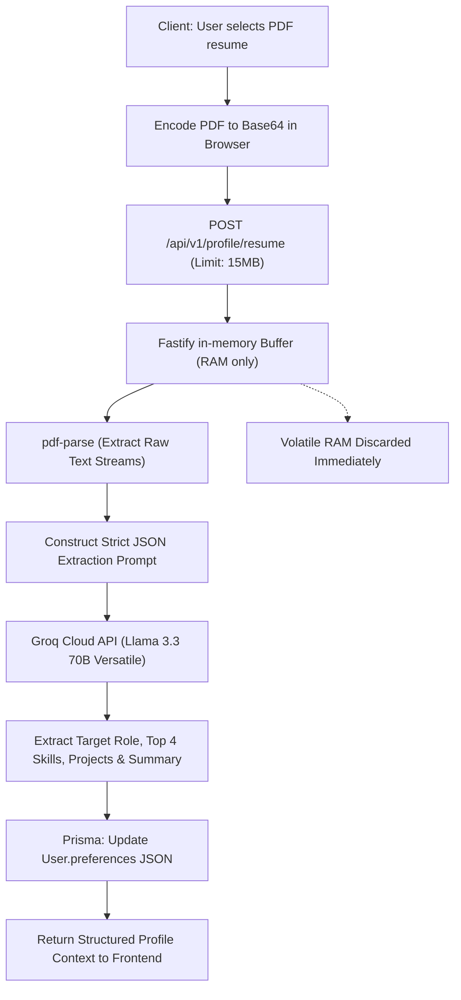
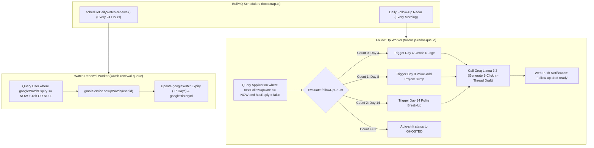
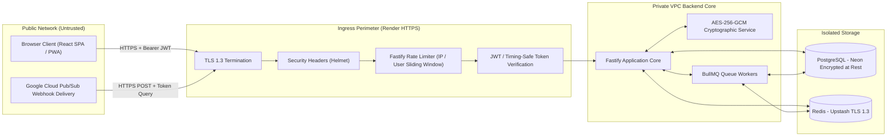

# ApplyTrack - System Architecture Blueprint

> **Aesthetic & Design Philosophy:** Cal AI / Linear-style minimal tracker with Zero-Effort Gmail Sync, Groq AI Follow-Up Ghostwriter, and PWA Mobile Share Target.  
> **Tech Stack:** React 18 (TypeScript + Vite) + Fastify 4 (TypeScript) + PostgreSQL (Neon / Prisma 5) + Redis & BullMQ 5 + Groq AI (Llama 3.3 70B) + Node Crypto (AES-256-GCM).

---

## 1. High-Level System Architecture

---

## 2. Real-Time Gmail Ingestion Flow (Killer Feature)

ApplyTrack monitors mailbox events without storing email bodies. It complies with least-privilege review guidelines using `gmail.metadata`.

---

## 3. Data Model & Entity Relationship Diagram (ERD)

Strictly reflects the centralized Prisma schema defined in [`packages/database/prisma/schema.prisma`](file:///d:/Backend%20Project/ApplyTrack/packages/database/prisma/schema.prisma):

> **Database Indexing & Integrity:**  
> * **Composite Unique Constraint:** `@@unique([userId, gmailThreadId])` prevents duplicate card insertion for the same user while permitting nulls.  
> * **Query Optimization Indexes:** `@@index([userId, status])`, `@@index([userId, nextFollowUpDate])`, `@@index([googleWatchExpiry])`.  
> * **Soft Delete Policy:** Destructive `DELETE` queries are prohibited across all models; records update `isArchived = true`.

---

## 4. Application Lifecycle & Kanban State Transitions

---

## 5. In-Memory Resume AI Context Vault (Privacy-First)

ApplyTrack processes candidate resumes without persisting files to disks or cloud buckets.

---

## 6. Automated Follow-Up Radar & Watch Renewal Architecture

---

## 7. Security, Trust Boundary & Data Isolation

### Cryptographic Security Vault Specifications
* **Algorithm:** `aes-256-gcm` (Authenticated Galois/Counter Mode).
* **Key Derivation:** Single 256-bit (32-byte) hex string stored in `TOKEN_ENCRYPTION_KEY`.
* **Payload Format:** `iv:authTag:encryptedData` (random 12-byte IV per encryption call, 16-byte authentication tag).
* **Encrypted Fields:**
  * User OAuth tokens: `encryptedGoogleToken`, `encryptedGithubToken`.
  * Candidate application details: `companyName`, `roleTitle`, `location`, `salaryRange`, `jobUrl`, `notes`.
* **Tamper Resistance:** Any manipulation of encrypted text fails authentication tag validation (`Unsupported state or unable to authenticate data`) and safely aborts without data leakage.

---

## 8. Concurrency & Rate-Limiting Controls

To prevent Google API quota burn, race conditions, and denial of service:
1. **Gmail Sync Debounce Lock (Redis Mutex):**
   * Endpoint: `POST /api/v1/applications/sync-gmail`
   * Atomic check: `SET lock:sync:{userId} "locked" EX 60 NX`
   * If lock exists, rejects immediately with `429 Too Many Requests` ("Sync is already running or on cooldown").
2. **Pub/Sub Webhook Deduplication:**
   * Incoming messages check `pubsub:msg:{messageId}` via `SETNX` with a 3600-second TTL.
   * Duplicate deliveries are acknowledged (`200 OK`) and discarded to eliminate redundant BullMQ queue jobs.
3. **Endpoint Rate Limits (Fastify Rate Limit Plugin):**
   * OAuth initiation: 20 req / 10 min.
   * OAuth callback: 30 req / 10 min.
   * Auth code exchange: 15 req / 10 min.
   * Resume PDF parsing: 10 req / hour.
   * Pub/Sub webhook receiver: 600 req / minute.
   * Follow-up draft generation: 30 req / hour.
